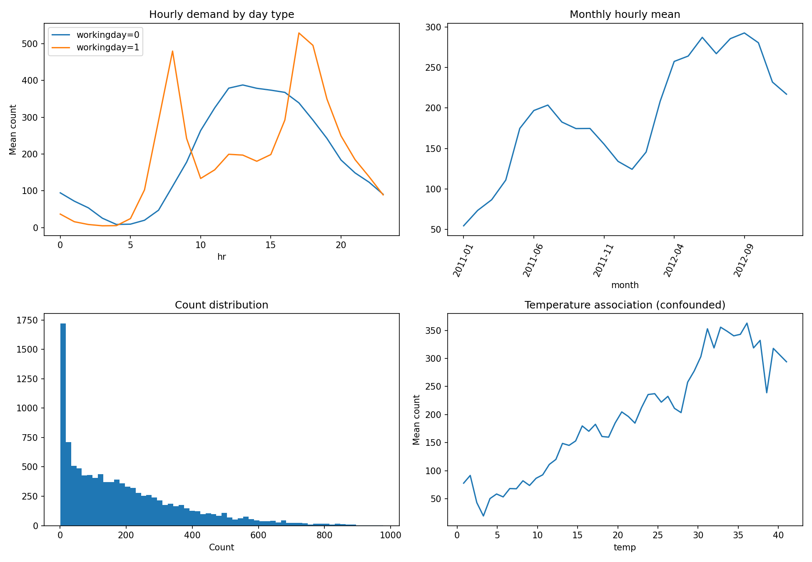
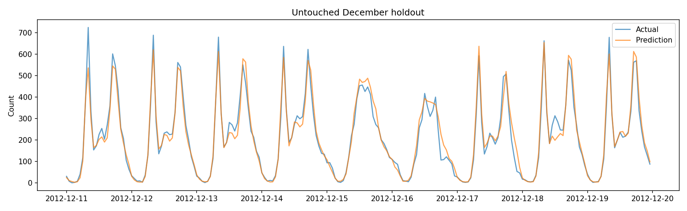

# 自転車需要予測の分析記録

## データ変換と保存
- raw/train.csv、raw/test.csvに入力原本を保存。train.csv、test.csvは指定の15列へ変換済み。
- idは各ファイルで1から連番。dtedayは日付、yrは2011=0/2012=1、weekdayは日曜=0〜土曜=6。
- temp、atemp、humはファイルごとに(min,max)でMin-Max正規化。係数はartifacts/normalization.json。
- testの未知cntは空欄。casual/registeredは指定列から除外し、原本だけに保持。
- モデルでは正規化係数から気象量を元の物理単位へ戻す。train/testで異なる正規化範囲を同じ尺度で扱い、検証時の正規化係数経由の将来情報も排除する。IDは予測特徴量に使わない。

## 実施したEDA
- train=10,886行、test=6,493行。欠損セルはともに0。
- 重複日時はtrain=0、test=0。両集合の日時重複=0。
- 2011〜2012年の全時刻に対する未収録時間=165。欠けた時間を需要ゼロと決めつけて補完しない。
- trainは毎月1〜19日、testは20日以降。ランダム分割では月内の先の情報を使えるため、時系列検証を採用。
- countの中央値=145.0、最大=977。RMSLEに合わせlog1p目的変数を使う。
- casual + registered = countが全行で成立。利用者構成の異なる需要を別々に学習する候補も用意。
- 風速ゼロは12.06%。ゼロを欠損と断定せず、ゼロ指標を特徴量候補にする。
- 気象カテゴリ4はtrainで1件。稀少カテゴリの評価は不安定。
- 温度と需要の関係は季節・時間帯との交絡を含む。単純相関を因果効果と解釈しない。

### 年別平均需要
| year | n | mean_count | mean_casual | mean_registered |
| --- | --- | --- | --- | --- |
| 2011 | 5422 | 144.22335 | 28.73792 | 115.48543 |
| 2012 | 5464 | 238.56094 | 43.25000 | 195.31094 |

### 勤務日別・時間帯平均
| hr | workingday | n | mean_count | mean_casual | mean_registered |
| --- | --- | --- | --- | --- | --- |
| 0 | 0 | 145 | 94.48966 | 17.02069 | 77.46897 |
| 0 | 1 | 310 | 36.73226 | 7.17419 | 29.55806 |
| 1 | 0 | 145 | 71.91034 | 13.04828 | 58.86207 |
| 1 | 1 | 309 | 16.00324 | 3.44660 | 12.55663 |
| 2 | 0 | 143 | 53.74825 | 10.61538 | 43.13287 |
| 2 | 1 | 305 | 8.43607 | 2.10164 | 6.33443 |
| 3 | 0 | 144 | 25.53472 | 6.29861 | 19.23611 |
| 3 | 1 | 289 | 4.89273 | 0.87889 | 4.01384 |
| 4 | 0 | 145 | 8.54483 | 2.34483 | 6.20000 |
| 4 | 1 | 297 | 5.36364 | 0.73401 | 4.62963 |
| 5 | 0 | 142 | 9.37324 | 1.82394 | 7.54930 |
| 5 | 1 | 310 | 24.52903 | 1.28710 | 23.24194 |
| 6 | 0 | 145 | 19.99310 | 3.86897 | 16.12414 |
| 6 | 1 | 310 | 102.57742 | 4.28065 | 98.29677 |
| 7 | 0 | 145 | 47.26897 | 8.71724 | 38.55172 |
| 7 | 1 | 310 | 290.69032 | 11.94194 | 278.74839 |
| 8 | 0 | 145 | 112.25517 | 20.46897 | 91.78621 |
| 8 | 1 | 310 | 479.94516 | 22.04516 | 457.90000 |
| 9 | 0 | 145 | 177.92414 | 45.73103 | 132.19310 |
| 9 | 1 | 310 | 242.29355 | 24.04516 | 218.24839 |
| 10 | 0 | 145 | 263.80690 | 80.13103 | 183.67586 |
| 10 | 1 | 310 | 133.59677 | 30.20968 | 103.38710 |
| 11 | 0 | 145 | 325.38621 | 109.12414 | 216.26207 |
| 11 | 1 | 310 | 157.01935 | 37.10000 | 119.91935 |
| 12 | 0 | 145 | 379.11034 | 129.79310 | 249.31724 |
| 12 | 1 | 311 | 199.34727 | 40.40836 | 158.93891 |
| 13 | 0 | 145 | 387.82069 | 142.35862 | 245.46207 |
| 13 | 1 | 311 | 197.16077 | 42.21543 | 154.94534 |
| 14 | 0 | 145 | 378.73103 | 145.02759 | 233.70345 |
| 14 | 1 | 311 | 180.36656 | 44.68167 | 135.68489 |
| 15 | 0 | 145 | 373.70345 | 142.19310 | 231.51034 |
| 15 | 1 | 311 | 198.62701 | 45.18006 | 153.44695 |
| 16 | 0 | 145 | 367.64828 | 133.71724 | 233.93103 |
| 16 | 1 | 311 | 292.46624 | 47.74598 | 244.72026 |
| 17 | 0 | 145 | 339.12414 | 116.04828 | 223.07586 |
| 17 | 1 | 311 | 529.20900 | 56.50804 | 472.70096 |
| 18 | 0 | 145 | 292.24828 | 87.09655 | 205.15172 |
| 18 | 1 | 311 | 495.48553 | 49.41479 | 446.07074 |
| 19 | 0 | 145 | 242.34483 | 67.55862 | 174.78621 |
| 19 | 1 | 311 | 349.28296 | 40.45659 | 308.82637 |
| 20 | 0 | 145 | 183.80690 | 49.90345 | 133.90345 |
| 20 | 1 | 311 | 249.36334 | 30.59164 | 218.77170 |
| 21 | 0 | 145 | 148.73793 | 38.17241 | 110.56552 |
| 21 | 1 | 311 | 184.85531 | 24.09003 | 160.76527 |
| 22 | 0 | 145 | 123.35172 | 29.75862 | 93.59310 |
| 22 | 1 | 311 | 138.34405 | 19.26688 | 119.07717 |
| 23 | 0 | 145 | 90.60690 | 20.35172 | 70.25517 |
| 23 | 1 | 311 | 88.99678 | 13.18328 | 75.81350 |

### 正規化の係数
| split | column | min | max |
| --- | --- | --- | --- |
| train | temp | 0.82000 | 41.00000 |
| train | atemp | 0.76000 | 45.45500 |
| train | hum | 0.00000 | 100.00000 |
| test | temp | 0.82000 | 40.18000 |
| test | atemp | 0.00000 | 50.00000 |
| test | hum | 16.00000 | 100.00000 |

## 特徴量と情報の時点
- basic: 月、年、曜日、時刻、季節、休日、勤務日、当該時刻に提供される気象。
- calendar: 経過日数、年内日、周期sin/cos、時刻×勤務日・曜日、通勤帯、月×勤務日、米国連邦祝日・前後日、年末日付を追加。
- full: 気温と体感温度の差、風速ゼロ、湿度ゼロ、気温×湿度、1/3/24時間前の気象・気象差を追加。
- 気象のラグは時刻キーで過去方向のみ参照。未来の実績需要、casual、registered、countを説明変数に入れない。
- testの既知気象も過去時刻のラグ計算に使用。未知の需要は一切参照しない。当該時刻の気象は問題で与えられた説明変数として扱う。
- 将来時刻の気象、全日集計、未来の需要を使うターゲットエンコーディングや需要ラグ、外部の正解データ取得は行わない。
- 連邦祝日はpandasのカレンダーから決定的に計算。元のholiday/workingdayも保持。

## 検証計画（モデル実行前に固定）
- 開発4fold: 2011-10、2012-02、2012-06、2012-10の11〜19日を評価。
- 各foldはその月10日23時以前のtrainの実績だけで学習。過去月でもtestに属する日の正解は存在せず使用しない。
- 学習対象日時は検証開始より厳密に前。9日間の連続予測で、実際の9〜12日間の予測に近づける。
- 最終ホールドアウト: 2012-12の11〜19日。モデルと混合比は開発4foldのみで選定し、この正解は選定に使わない。
- RMSLEを主指標とし、foldを結合した予測で算出。単純なfold平均も別記。
- 反復回数は事前固定。検証/ホールドアウトでのearly stoppingを使わない。
- 最終ホールドアウトも平常期の9日間であり、年末・悪天候・本番順位の精度を保証しない。
- 同一月末へ予測する実運用との差、少数foldによるばらつき、2011初期の短い履歴を制約として残す。

## 実行ログ
EDAと検証計画を保存済み。以降の実験はartifacts/experiment_log.jsonlへ逐次追記。

## 実験結果
| model | pooled_rmsle | mean_fold_rmsle |
| --- | --- | --- |
| cat_deep | 0.27196 | 0.26701 |
| lgb_components | 0.27457 | 0.26989 |
| cat_components | 0.27548 | 0.27041 |
| xgb_weather | 0.27804 | 0.27249 |
| cat_weather | 0.27924 | 0.27362 |
| lgb_weather | 0.27941 | 0.27394 |
| lgb_smooth | 0.28030 | 0.27586 |
| cat_calendar | 0.29386 | 0.28768 |
| lgb_basic | 0.29403 | 0.29066 |
| lgb_calendar | 0.29621 | 0.29153 |
| baseline | 0.46867 | 0.46505 |

### fold別結果
| model | 2011-10 | 2012-02 | 2012-06 | 2012-10 |
| --- | --- | --- | --- | --- |
| baseline | 0.46686 | 0.55175 | 0.38841 | 0.45316 |
| cat_calendar | 0.36649 | 0.32509 | 0.21881 | 0.24034 |
| cat_components | 0.34232 | 0.30024 | 0.21505 | 0.22402 |
| cat_deep | 0.32544 | 0.31049 | 0.20357 | 0.22856 |
| cat_weather | 0.34263 | 0.31362 | 0.20696 | 0.23129 |
| lgb_basic | 0.35049 | 0.31718 | 0.24232 | 0.25263 |
| lgb_calendar | 0.36461 | 0.31768 | 0.23021 | 0.25361 |
| lgb_components | 0.33346 | 0.30459 | 0.20888 | 0.23262 |
| lgb_smooth | 0.33459 | 0.31579 | 0.21915 | 0.23392 |
| lgb_weather | 0.34810 | 0.30565 | 0.21088 | 0.23113 |
| xgb_weather | 0.33487 | 0.31958 | 0.20605 | 0.22947 |

- baselineは時刻×勤務日×月の過去log需要平均（未観測組合せは時刻×勤務日にフォールバック）。
- basic→calendar→fullの比較で暦・気象派生特徴の追加効果を確認。ライブラリ間・深さ・平滑化・利用者区分別学習を比較。
- component系はcasual/registeredを別モデルでlog1p学習し、元の件数へ戻して合算。これらは目的変数としてのみ使用。
- 開発スコアによる上位4候補のlog1p予測を非負・総和1で混合。重みは開発データのみで最適化。
- 選択モデルと重み: {"cat_deep": 0.4952224686703541, "lgb_components": 0.4112346993906138, "cat_components": 0.0935428319390322, "xgb_weather": 0.0}。
- 開発混合RMSLE=0.268224、単体最良=0.271959。
- foldを1つ除いて重みを学習した交差確認のfold平均=0.266054。
- この交差確認は上位モデル選択自体をネストしていないため、独立評価とは扱わない。最終ホールドアウトが独立評価。

## 一度だけ行った最終ホールドアウト
| fold | train_rows | validation_rows | baseline_rmsle | best_single_rmsle | blend_rmsle |
| --- | --- | --- | --- | --- | --- |
| 2012-12 | 10670 | 216 | 0.40334 | 0.25430 | 0.24462 |

- ホールドアウトの結果に応じたモデル・重み・ハイパーパラメータの変更は行っていない。
- 予測誤差の時刻別・勤務日別・気象別集計はartifacts/holdout_error_slices.csv。

## 最終学習・提出ファイル
- 選択済みモデルを全10,886行で再学習し、testの原順序に対して予測。
- submit.csvはid,cntの2列、6,493行。idは1〜6493、欠損・無限値・負値なし。
- 予測件数の範囲: 1.0457〜881.0506、平均=188.0642。RMSLE目的のため整数丸めは行わない。
- 変換、EDA、特徴量生成、開発検証、選定、ホールドアウト、最終予測の全手順はanalysis.py。
- 実験ごとの予測・foldスコア・混合比・環境バージョン・モデル・重要度をartifactsに保存。
- 入力原本のSHA256はartifacts/environment.json。提出ファイルSHA256はartifacts/submission_checks.json。
- 同じ原本・同じ依存環境・同じseedで再実行可能。ライブラリ/OS差で微小な数値差が生じる場合がある。
- 実際のtest正解は未知であり、本番RMSLE・Kaggle順位は算出していない。

## 再実行
1. Python 3.12でpython -m pip install -r requirements.txtを実行。
2. python analysis.pyで全工程を再現。既存rawは上書きせず、形式変換を何度実行しても原本から再構成。
3. 開発予測キャッシュを使わず再学習する場合はpython analysis.py --fresh。
4. 形式変換とEDAのみならpython analysis.py --prepare-only。

## 結果の解釈と追加診断

- 開発4期間の混合モデルRMSLEは0.268224。過去平均ベースライン比で42.8%改善。
- 未使用だった12月ホールドアウトのRMSLEは0.244623、ベースライン比で39.4%改善。
- 両者は別期間の指標であり、開発とホールドアウトの大小をそのまま性能改善とは扱わない。

### 同一設定内の比較
差分は負なら改善、正なら悪化。開発4期間を結合したRMSLEで比較。
| comparison | before_rmsle | after_rmsle | delta_after_minus_before |
| --- | --- | --- | --- |
| LightGBM: basicから暦特徴追加 | 0.29403 | 0.29621 | 0.00218 |
| LightGBM: 暦から気象派生追加 | 0.29621 | 0.27941 | -0.01680 |
| CatBoost: 暦から気象派生追加 | 0.29386 | 0.27924 | -0.01462 |
| CatBoost: 総数直接から区分別合算 | 0.27924 | 0.27548 | -0.00375 |

- 特徴量の追加は常に改善するわけではない。上表の実測値に従って最終候補を選定した。
- モデル重要度は各ライブラリの定義が異なり、モデル間の絶対値比較や因果解釈には使わない。
| model | target | top_features |
| --- | --- | --- |
| cat_components | casual | hr, hour_workday, atemp, temp, month_workday, hr_cos, elapsed_day, hr_sin |
| cat_components | registered | hour_workday, night, hr_sin, hr_cos, elapsed_day, weekend, hr, month_workday |
| cat_deep | count | hour_workday, night, hr_sin, hr_cos, elapsed_day, hr, weekend, yr |
| lgb_components | casual | elapsed_day, hour_workday, hr, hour_weekday, dayofyear_cos, temp_change24, hum_lag24, dayofyear |
| lgb_components | registered | hour_workday, hr, hour_weekday, elapsed_day, hr_cos, hour_season, temp_change24, dayofyear_sin |

### EDAで確認した注意点
- workingdayと「平日かつholiday=0」の不整合は0行。
- 勤務日は8時・17〜18時、非勤務日は昼過ぎに需要が集中。勤務日×時刻の交互作用を追加する根拠となった。
- 湿度ゼロは22行。真の観測か異常かは確定できないため、元の値を保持してゼロ指標を追加。
- 2012-08-17には高温にもかかわらず体感温度が低い記録がある。外部の根拠なく値を修正せず、気温と体感温度の差を特徴量にした。
| datetime | temp | atemp | humidity | weather |
| --- | --- | --- | --- | --- |
| 2012-08-17 14:00:00 | 35.26000 | 12.12000 | 34 | 1 |
| 2012-08-17 15:00:00 | 35.26000 | 12.12000 | 30 | 1 |
| 2012-08-17 13:00:00 | 34.44000 | 12.12000 | 36 | 1 |
| 2012-08-17 16:00:00 | 34.44000 | 12.12000 | 32 | 2 |
| 2012-08-17 12:00:00 | 33.62000 | 12.12000 | 41 | 1 |

### train/testの気象・暦の平均値
| feature | train_mean | test_mean |
| --- | --- | --- |
| temp | 20.23086 | 20.62061 |
| atemp | 23.65508 | 24.01286 |
| humidity | 61.88646 | 64.12521 |
| windspeed | 12.79940 | 12.63116 |
| holiday | 0.02857 | 0.02911 |
| workingday | 0.68087 | 0.68582 |

### 適用上の前提と残る不確実性
- 開発・最終ホールドアウトでは評価開始以降の実績を学習に使わない。
- 最終提出は配布されたtrain全体を既知の教師データとして再学習するコンペ形式。各test時点までの行だけで逐次学習するオンライン運用のシミュレーションとは異なる。
- 毎月20日以降の正解がないため、月末そのものやクリスマス期の精度は検証できない。月内の日にちそのものは特徴量から除外した。
- 今回の開発期間は2011-10以降。特に履歴の短い2011年初期への精度は独立には測定していない。
- 気象ラグは欠けた時間があれば欠損のまま扱う。全体を先読みして補間しない。
- 検証用気象・testの説明変数は提供済みとする。実運用で当該時刻の気象が未観測なら気象予報に置換した再評価が必要。
- 再現チェックはpython verify_outputs.py --models。保存モデルからの予測、混合比、submit.csvの一致も確認できる。
